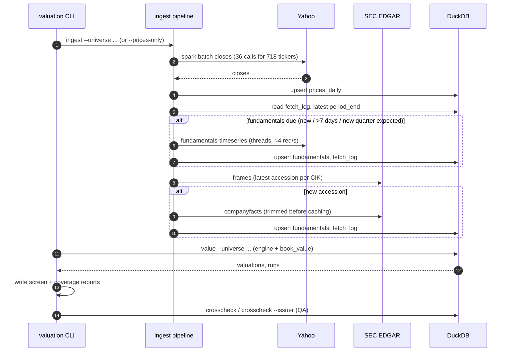

# System architecture (SW)

Status: as built on 2026-11-09 (book_value 0.2.0, incremental ingest). Planned components are dashed.

## Data flow

```mermaid
flowchart LR
    subgraph EXT["External sources"]
        YQ["Yahoo spark<br/>batch prices (20/call)"]
        YT["Yahoo fundamentals-timeseries<br/>TSX balance sheet + currency"]
        YP["Yahoo quoteSummary<br/>profile (monthly, crumb)"]
        YC["Yahoo chart<br/>fallback prices / currency"]
        EF["SEC EDGAR frames<br/>who filed? (1 call/quarter)"]
        EC["SEC EDGAR companyfacts<br/>US fundamentals + filed dates"]
        BOC["Bank of Canada Valet<br/>USD/CAD"]
        XIC["iShares XIC holdings<br/>TSX Composite + GICS"]
        WIKI["Wikipedia<br/>S&P 500 + GICS + CIK"]
        IR["Issuer supplementary packs<br/>RY / TD / BNS / MFC PDFs"]
        FRED["FRED DGS10 / BoC 10y<br/>risk-free (planned)"]:::planned
    end

    subgraph ING["Ingestion (src/valuation/ingest, providers)"]
        UB["universe_build<br/>valuation universe"]
        PIPE["pipeline.ingest<br/>refresh policy + fetch_log<br/>4 threads, rate limiters"]
        CACHE[("data/raw/&lt;source&gt;/&lt;day&gt;<br/>raw response cache")]
    end

    UNI[/"universe/*.csv<br/>reference (14) · tsx_composite (215) · sp500 (503)"/]

    subgraph DB["DuckDB data/valuation.duckdb"]
        SEC[(securities)]
        PR[(prices_daily)]
        FU[(fundamentals<br/>keyed by filed_date)]
        FX[(fx_daily)]
        REF[(reference_metrics)]
        FL[(fetch_log)]
        VAL[(valuations + runs)]
    end

    subgraph MOD["Valuation (engine.py, models/)"]
        ENG["engine.build_inputs<br/>select_latest_filing (no look-ahead)<br/>FX, share-class conversion"]
        BV["book_value 0.2.0<br/>BVPS, P/B, peer median FV"]
        RI["Model A residual income"]:::planned
        PB["Model B peer regression"]:::planned
        CMP["Model C factor composite"]:::planned
        ELIG["eligibility filter"]:::planned
        BT["backtest harness"]:::planned
    end

    subgraph OUT["Outputs (reports/&lt;date&gt;/)"]
        SCR["screen_book_value.csv / .parquet"]
        COV["coverage_book_value.csv"]
        SIG["screen_signals.csv<br/>BUY / HOLD / SELL"]:::planned
    end

    subgraph QA["QA (src/valuation/qa, tests/)"]
        XC["crosscheck vs Yahoo"]
        IC["crosscheck --issuer<br/>vs issuer BVPS"]
        T["pytest: spec tests from AN docs<br/>parser fixtures, offline pipeline"]
    end

    XIC --> UB
    WIKI --> UB
    UB --> UNI --> PIPE
    YQ & YT & YP & YC & EF & EC & BOC --> PIPE
    FRED -.-> PIPE
    PIPE <--> CACHE
    PIPE --> SEC & PR & FU & FX & REF & FL
    SEC & PR & FU & FX --> ENG
    ENG --> BV --> VAL
    ENG -.-> ELIG -.-> RI & PB & CMP
    RI & PB & CMP -.-> SIG
    RI & PB & CMP -.-> BT
    VAL --> SCR & COV
    VAL --> XC
    REF --> XC
    VAL --> IC
    IR --> IC

    classDef planned stroke-dasharray: 5 5,fill:#f6f6f6,color:#666;
```

## Daily run (incremental)

## Key properties
| Property | How |
|---|---|
| No look-ahead | Fundamentals keyed by `filed_date`; `select_latest_filing` and a guard in `compute_book_value`; prices `≤ as_of` |
| Reproducible | Raw responses cached per day; each valuation row stores `inputs_json`, `model_version`, and the run's git SHA |
| Idempotent | `INSERT OR REPLACE` upserts on natural keys; re-runs are a no-op |
| Fast daily run | Batch prices plus a refresh policy (`fetch_log`): ~1 min for 718 tickers; first load ~19 min |
| Spec ↔ code | AN spec → QA tests written from the spec → SW implementation → external cross-checks |
