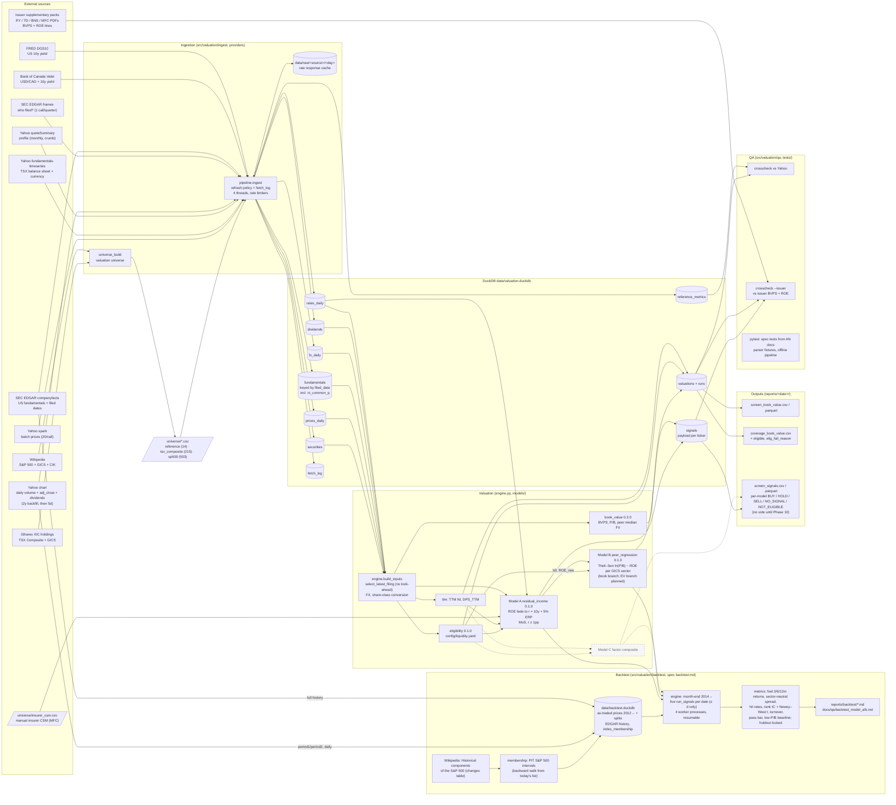

# System architecture (SW)

Status: as built on 2026-11-09 (book_value 0.2.0, Phase 6 data batch 1 + eligibility 0.1.0, Phase 7 Model A
residual_income 0.1.0 + Model B peer_regression 0.1.0 book branch + report v2, Phase 8 backtest 0.1.0). Planned
components are dashed.

## Data flow


## Daily run (incremental)
```mermaid
sequenceDiagram
    autonumber
    participant CLI as valuation CLI
    participant P as ingest pipeline
    participant Y as Yahoo
    participant E as SEC EDGAR
    participant D as DuckDB
    CLI->>P: ingest --universe ... (or --prices-only)
    P->>Y: spark batch closes (36 calls for 718 tickers)
    Y-->>P: closes
    P->>D: upsert prices_daily
    P->>Y: chart per ticker (5d; 2y on first load / new dividend or split), ≈4 req/s
    Y-->>P: close, adj_close, volume, dividends
    P->>D: upsert prices_daily (volume), dividends
    P->>D: read fetch_log, latest period_end
    alt fundamentals due (new / >7 days / new quarter expected)
        P->>Y: fundamentals-timeseries (threads, ≈4 req/s)
        P->>D: upsert fundamentals, fetch_log
    end
    P->>E: frames (latest accession per CIK)
    alt new accession
        P->>E: companyfacts (trimmed before caching)
        P->>D: upsert fundamentals (+ quarterly NI), fetch_log
    end
    P->>P: BoC 10y + FRED DGS10 → rates_daily
    CLI->>D: value --universe ... (engine + book_value)
    D-->>CLI: valuations, runs
    CLI->>CLI: eligibility filter, TTM NI, DPS, rf; write screen + coverage reports
    CLI->>CLI: Model A per ticker, then Model B per sector (pooled TSX + US); write screen_signals
    CLI->>D: crosscheck / crosscheck --issuer (QA)
```

## Key properties
| Property | How |
|---|---|
| No look-ahead | Fundamentals keyed by `filed_date`; `select_latest_filing` and a guard in `compute_book_value`; quarterly NI emitted per filing date (a derived Q4 gets the 10-K date); prices, dividends and rates `≤ as_of` (not even stored beyond it) |
| Reproducible | Raw responses cached per day; each valuation row stores `inputs_json`, `model_version`, and the run's git SHA |
| Idempotent | `INSERT OR REPLACE` upserts on natural keys; re-runs are a no-op |
| Fast daily run | Batch prices, one 5-day chart call per ticker for volume, and a refresh policy (`fetch_log`): 251 s for 718 tickers (≤ 5 min target); first load ~45 min incl. the 2-year history backfill |
| Signals are not advice | Every screen_signals file starts with the disclaimer line (Parquet: metadata `disclaimer`); per-model labels only, no vote before Phase 10 |
| Backtest point in time | Own DB; prices stored as traded (Yahoo split adjustment undone) so price × shares-as-filed is a real market cap; shares × splits in (filed, d], dividends ÷ splits in (ex, d]; facts `filed_date ≤ d` (+30 days for estimated Yahoo dates); membership on d from the Wikipedia changes table; holdout (last 36 month-ends) computed only with `--holdout`, logged in `bt_runs` with a thresholds hash |
| Spec ↔ code | AN spec → QA tests written from the spec → SW implementation → external cross-checks |
